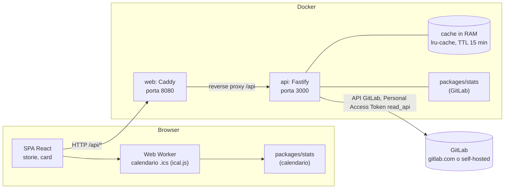

# Architettura

Git Wrapped ha due container e un servizio esterno. Ognuno lo avvia in locale con il proprio Personal Access Token, e l'app mostra solo il wrapped del proprietario del token. Il confine della privacy è netto: il calendario si elabora nel browser, mentre i dati GitLab passano solo in memoria dentro il container `api`.

## Diagramma

Il file `.ics` non compare nel flusso verso il server: viene letto dal Web Worker, che non fa richieste di rete, e le statistiche restano nel browser.

Caddy serve anche la SPA, con header di sicurezza e CSP `connect-src 'self'`. La porta 3000 dell'API non è esposta: solo `web` pubblica la porta 8080.

## Pacchetti del monorepo

| Pacchetto            | Ruolo                                                                                                                                                                                                               |
| -------------------- | ------------------------------------------------------------------------------------------------------------------------------------------------------------------------------------------------------------------- |
| `apps/api`           | Server Fastify. Espone le rotte, valida le richieste e le risposte con i contratti, tiene la cache in memoria, redige i log. Il collettore GitLab sta in `src/gitlab`, il confine con il server in `src/source.ts`. |
| `apps/web`           | SPA React. Schermata iniziale (`setup`), storie a schermo intero (`story`), card ed export PNG (`cards`), modulo calendario (`calendar`, con il Web Worker), tema (`theme`).                                        |
| `packages/contracts` | Schemi zod e tipi TypeScript condivisi: `RawActivity`, `WrappedStats`, `CalendarStats`, cataloghi di badge e personalità, rotte API. Congelato al tag `contracts-v4`.                                               |
| `packages/stats`     | Motore statistiche e badge, funzioni pure senza I/O. Gira nel server (statistiche GitLab) e nel browser (calendario).                                                                                               |
| `packages/copy`      | Tutti i testi in italiano, indicizzati dalle chiavi dei contratti.                                                                                                                                                  |
| `packages/fixtures`  | Team finto, un anno di attività generato con seed fisso, file `.ics` di esempio. Usato dalla modalità demo (che mostra un membro fisso) e dai test.                                                                 |
| `docker/`            | Dockerfile multi-stage per `api` e `web`, Caddyfile. Le stesse immagini sono pubblicate su `ghcr.io` per il [kit](kit.md).                                                                                          |
| `e2e/`               | Test end-to-end con Playwright sul percorso completo in modalità demo.                                                                                                                                              |

Lo stesso motore `packages/stats` è importato sia dal server sia dal browser. Il server non usa il calendario e il browser non chiama GitLab.

## Impostazioni dalla schermata iniziale

Senza `GITLAB_TOKEN` nel `.env` (e senza `DEMO_MODE=true`) l'app si apre sulla schermata iniziale: indirizzo di GitLab, gruppo e token. Il browser li manda una volta con `POST /api/settings` (intestazione anti-CSRF `x-git-wrapped: 1`); l'API crea una sorgente GitLab nuova, verifica subito utente (`GET /user`) e, se indicato, il gruppo, e solo allora la rende attiva con cache nuove, così nulla di quanto letto con il token precedente sopravvive. Il token resta nella RAM del container `api`: al riavvio va reinserito, oppure il browser lo ripropone se l'utente ha scelto «Ricorda su questo browser». `DELETE /api/settings` dimentica tutto.

## Flusso di una richiesta `GET /api/me`

1. Il browser chiede `/api/me?year=...`. La richiesta arriva a Caddy (`web`), che la inoltra ad `api`.
2. Fastify valida la query con gli schemi dei contratti. Un input non valido riceve un `ApiError` con `code: bad_request`.
3. L'API chiede a GitLab a chi appartiene il token (`GET /user`). Un token mancante, scaduto o revocato riceve `401` con `code: unauthorized`; un token di un bot (Group o Project Access Token) riceve `403` con `code: bot_token`. In modalità demo la persona è un membro fisso del team finto.
4. Se la cache ha già le statistiche di quella persona per l'anno, le restituisce.
5. Altrimenti il collettore (`src/gitlab`, o la sorgente demo in modalità demo) scarica i dati e produce un `RawActivity`, paginando le risposte e gestendo i limiti di frequenza con retry. Se la persona non ha attività leggibili nei gruppi letti, l'API risponde `404` con `code: not_found`.
6. `computeWrappedStats` di `packages/stats` trasforma il `RawActivity` in `WrappedStats`. L'elenco dei membri dei gruppi serve solo a dare un nome al partner del duetto e non viene esposto.
7. La risposta viene validata con il contratto, salvata in cache per `CACHE_TTL_MINUTES` e restituita al browser.
8. In caso di errore, il server risponde con un `ApiError` il cui messaggio non contiene dati personali.

Nessun passo scrive su disco o su un database. Il corpo delle risposte GitLab non viene scritto nei log.

## Contratti condivisi

`packages/contracts` è l'unica fonte di verità per le forme dei dati. Tutti i pacchetti dipendono dai contratti e nessun pacchetto dipende da un altro pacchetto per i tipi. Il catalogo dei contratti, con gli esempi JSON, è in [docs/contracts.md](contracts.md).

Le richieste di modifica dei contratti passano da [docs/contract-requests.md](contract-requests.md).
