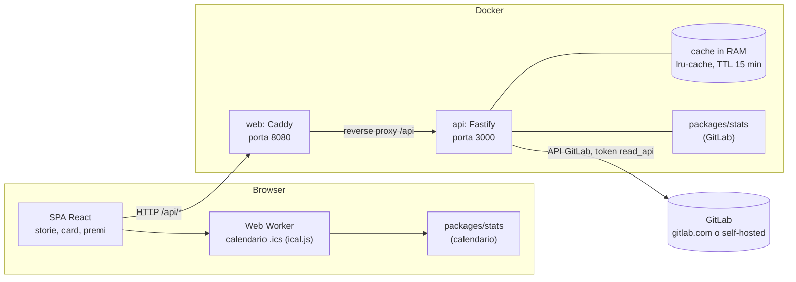

# Architettura

Git Wrapped ha due container e un servizio esterno. Il confine della privacy è netto: il calendario si elabora nel browser, mentre i dati GitLab passano solo in memoria dentro il container `api`.

## Diagramma

Il file `.ics` non compare nel flusso verso il server: viene letto dal Web Worker, che non fa richieste di rete, e le statistiche restano nel browser.

Caddy serve anche la SPA, con header di sicurezza e CSP `connect-src 'self'`. La porta 3000 dell'API non è esposta: solo `web` pubblica la porta 8080.

## Pacchetti del monorepo

| Pacchetto            | Ruolo                                                                                                                                                                                                               |
| -------------------- | ------------------------------------------------------------------------------------------------------------------------------------------------------------------------------------------------------------------- |
| `apps/api`           | Server Fastify. Espone le rotte, valida le richieste e le risposte con i contratti, tiene la cache in memoria, redige i log. Il collettore GitLab sta in `src/gitlab`, il confine con il server in `src/source.ts`. |
| `apps/web`           | SPA React. Storie a schermo intero (`story`), card ed export PNG (`cards`), pagina dei premi (`team`), modulo calendario (`calendar`, con il Web Worker), tema (`theme`).                                           |
| `packages/contracts` | Schemi zod e tipi TypeScript condivisi: `RawActivity`, `WrappedStats`, `TeamAwards`, `CalendarStats`, cataloghi di badge, personalità e premi, rotte API. Congelato al tag `contracts-v1`.                          |
| `packages/stats`     | Motore statistiche e badge, funzioni pure senza I/O. Gira nel server (statistiche GitLab) e nel browser (calendario).                                                                                               |
| `packages/copy`      | Tutti i testi in italiano, indicizzati dalle chiavi dei contratti.                                                                                                                                                  |
| `packages/fixtures`  | Team finto, un anno di attività generato con seed fisso, file `.ics` di esempio. Usato dalla modalità demo e dai test.                                                                                              |
| `docker/`            | Dockerfile multi-stage per `api` e `web`, Caddyfile.                                                                                                                                                                |
| `e2e/`               | Test end-to-end con Playwright sul percorso completo in modalità demo.                                                                                                                                              |

Lo stesso motore `packages/stats` è importato sia dal server sia dal browser. Il server non usa il calendario e il browser non chiama GitLab.

## Flusso di una richiesta `GET /api/wrapped/:username`

1. Il browser chiede `/api/wrapped/:username?year=...`. La richiesta arriva a Caddy (`web`), che la inoltra ad `api`.
2. Fastify valida i parametri con gli schemi dei contratti. Un input non valido riceve un `ApiError` con `code: bad_request`.
3. L'API verifica che lo username sia un membro del gruppo. Se non lo è, risponde `404` con `code: not_found`.
4. Se la cache ha già le statistiche di quella persona per l'anno, le restituisce.
5. Altrimenti il collettore (`src/gitlab`, o la sorgente demo in modalità demo) scarica i dati e produce un `RawActivity`, paginando le risposte e gestendo i limiti di frequenza con retry.
6. `computeWrappedStats` di `packages/stats` trasforma il `RawActivity` in `WrappedStats`.
7. La risposta viene validata con il contratto, salvata in cache per `CACHE_TTL_MINUTES` e restituita al browser.
8. In caso di errore, il server risponde con un `ApiError` il cui messaggio non contiene dati personali.

Nessun passo scrive su disco o su un database. Il corpo delle risposte GitLab non viene scritto nei log.

## Contratti condivisi

`packages/contracts` è l'unica fonte di verità per le forme dei dati. Tutti i pacchetti dipendono dai contratti e nessun pacchetto dipende da un altro pacchetto per i tipi. Il catalogo dei contratti, con gli esempi JSON, è in [docs/contracts.md](contracts.md).

Le richieste di modifica dei contratti passano da [docs/contract-requests.md](contract-requests.md).
